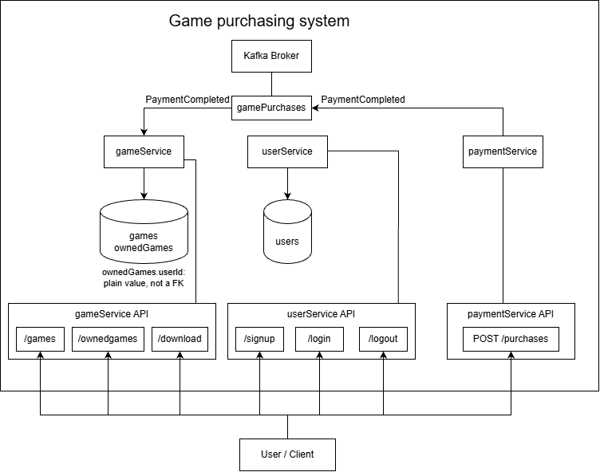

# Game purchasing system Apache Kafka task

## Problem statement

A large portion of video games that are produced need to be paid for. This system hosts the game files themselves behind a paywall. When a user pays for a game, they unlock it and can thus download it on their system. Users who haven't paid can only read a description and subsequently choose to buy or not buy the game. In this task, a game file is represented by a small text file.

## Service responsibility

1. userService - Handles user registration, login, logout and user data storage (/login, /signup, /logout).
2. gameService - Handles actions related to viewing games, downloading owned games and making sure users can only access owned games (/games, /ownedgames, /download).
3. paymentService - Handles users purchasing games (POST /purchases). If successful produces a new event with Apache Kafka.

Each service has its own database: userService has users, gameService has one database with the tables games and ownedGames, and paymentService has none.

## Events

- gamePurchases - produced by paymentService for every successful payment (event - PaymentCompleted) and consumed by gameService to unlock that game.

Fields:
- purchaseId (string) - unique ID of the purchase
- userId (integer) - the user who paid
- gameId (integer) - the game that was bought
- timestamp (integer) - Unix time in seconds

Example JSON:

```json
{
  "purchaseId": "b7e1c2a4-3f5d-4c8e-9a1b-6d2f0e7c4a91",
  "userId": 12,
  "gameId": 35,
  "timestamp": 1795525360
}
```

## Architecture diagram



## Main flow

1. User attempts to log-in (POST /login)
2. Provided credentials are correct, the user is logged in and the client receives the user's userId
3. User finds a game they want to purchase (/games)
4. The user clicks "purchase" on the games page, and the client sends POST /purchases with userId and gameId to paymentService
5. paymentService processes the simulated payment. If it fails, the client receives an HTTP 402 error message and no event is published
6. Payment is successful and paymentService produces a PaymentCompleted event
7. gameService consumes the event and the game is now owned by the user
8. User downloads the game from their "Owned games" section (/ownedgames, then /download)
9. User logs out (POST /logout)

## Assumptions and simplifications

- Identifying users: After login the client keeps the userId and sends it in every request (purchase, owned games, download). There are no tokens or sessions and no real security. The services simply trust it.
- Logout: There is no server-side session, so /logout just returns OK and the client forgets the userId.
- Simulated payment: There is no real payment provider. A payment succeeds by default and fails when the request contains simulateFailure=true, so the failure case can be tested. On failure the client gets an HTTP 402 with an error message, no event is published and nothing is stored.
- Invalid IDs: paymentService does not know which users and games exist, and services do not call each other, so a purchase for a non-existent game still produces a PaymentCompleted event. gameService cannot insert it (the gameId foreign key fails), so it logs a warning and skips the event. A non-existent userId cannot be detected by gameService, because it has no access to users. The row is inserted but is harmless, since nobody can log in as that user.
- Download: GET /download (with userId and gameId) returns a small text file standing in for the game, only if ownedGames has a row for that user and game. Otherwise, it returns HTTP 403.
- Payment records: paymentService has no database on purpose. Only successful purchases are saved, as rows in ownedGames.

## Design questions

1. What triggers paymentService? - The client's POST /purchases request.
2. What data is in the event? - Can gameService do its work using only the event? purchaseId, userId, gameId and timestamp. Yes, it only needs userId and gameId to add a row to ownedGames.
3. What happens if the same event arrives twice? - Could a user own the same game twice? No. ownedGames has a unique constraint on (userId, gameId), so the database rejects the second insert with an error. gameService does not check first: it inserts, catches that error, logs "already owned" and carries on.
4. What happens if gameService is down when the payment completes? - Kafka keeps the event in the topic. When gameService restarts it continues from its last committed offset and processes it. Until then the user has paid (the client got a success response) but the game is not yet in their owned games. It appears once gameService is back.
5. Where is each purchase saved in a database? - As a row in ownedGames in gameService's database. paymentService has no database, so failed payments and payment history are not saved.